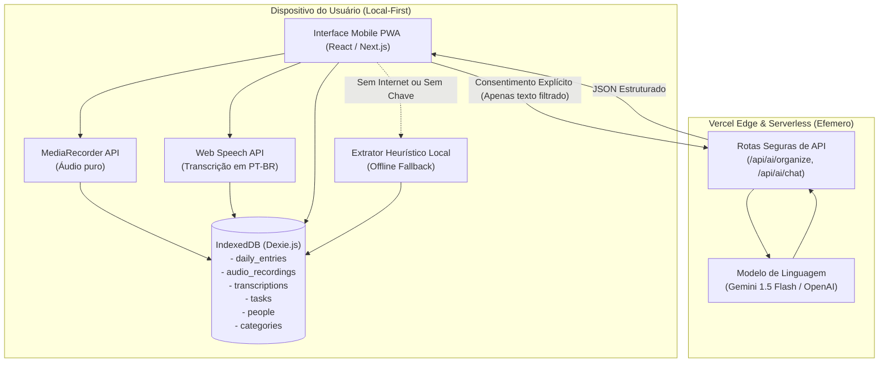

# DAYLOG AI — Arquitetura Técnica & Decisões de Design

## 1. Visão Geral da Arquitetura Local-First

O **DAYLOG AI** é construído sob o princípio fundamental de **Soberania e Privacidade de Dados (Local-First)**.

A aplicação opera sem banco de dados remoto para dados pessoais. Toda e qualquer informação gerada pelo usuário reside unicamente no armazenamento local do dispositivo (IndexedDB via Dexie.js).

## 2. Componentes & Tecnologias

- **Framework:** Next.js 14 com App Router (React 18 + TypeScript).
- **Estilo:** Tailwind CSS com paleta luxuosa escura (`#080A0B`, `#121619`, `#191E22`, `#F59E0B`).
- **Banco de Dados Local:** IndexedDB gerenciado pelo Dexie.js (versão 4).
- **Gravação de Áudio:** MediaRecorder com AudioContext para análise em tempo real de decibéis e visualização.
- **Transcrição:** Web Speech API integrada nativamente em português (pt-BR) com fallback para digitação manual direta.
- **IA e Privacidade:** Rotas efêmeras `/api/ai/organize` e `/api/ai/chat`. As credenciais ficam protegidas no servidor ou são injetadas localmente pelo usuário no client-side. Nenhum log ou persistência ocorre no servidor.
- **Segurança de Backup:** Exportação completa de relatos e áudios em formato JSON e `.daylog` com criptografia nativa AES-GCM (256-bit) e derivação PBKDF2 (100.000 iterações) via Web Crypto API.

## 3. Modelo de Entidades do IndexedDB

1. `daily_entries`: Relatos diários, índices por data, título, status de organização por IA.
2. `audio_recordings`: Blobs originais de áudio em formato nativo (WebM / MP4), duração em segundos e metadados.
3. `transcriptions`: Transcrições de texto vinculadas ao relato e áudio, com marcação de edição manual.
4. `categories`: Categorias padrões e personalizadas (Pessoal, Trabalho, Ideias, Saúde, Finanças, Projetos).
5. `tasks`: Tarefas com prioridade (`low`, `medium`, `high`), prazo e relacionamento direto com o relato de origem (`entryId`).
6. `people`: Pessoas identificadas nos relatos e contagem de menções.
7. `entry_people`: Tabela associativa entre relatos e pessoas.
8. `ai_summaries`: Resumos estruturados consolidados por período.
9. `ai_conversations` & `ai_messages`: Histórico de conversas com a Memória IA e citações das evidências.
10. `ai_memory_index`: Índice de busca por palavras-chave e entidades.
11. `user_settings`: Preferências do usuário, nome, consentimento de IA e chave de API opcional.
